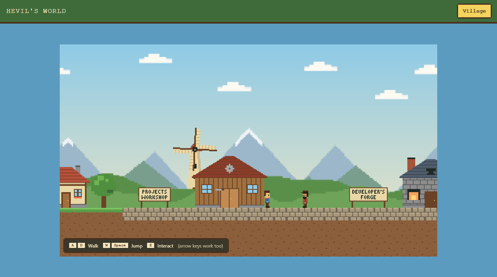
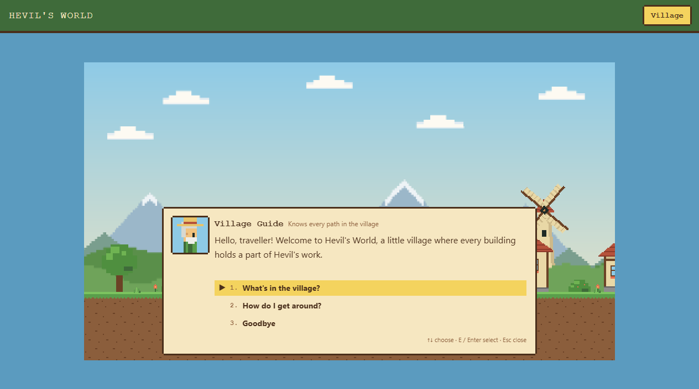
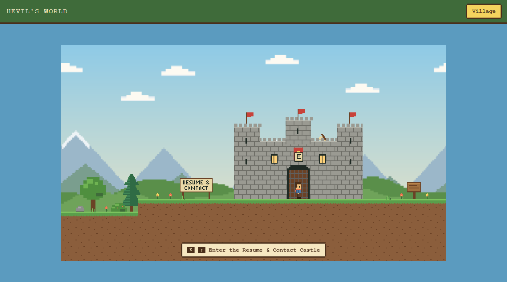
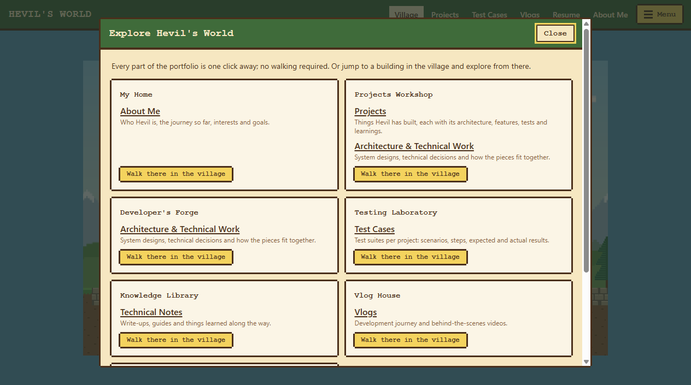
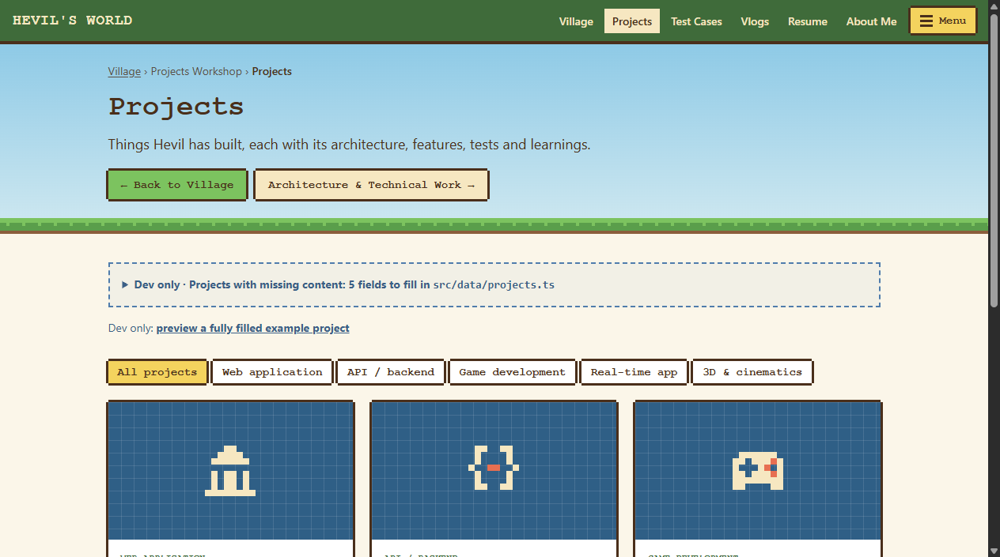
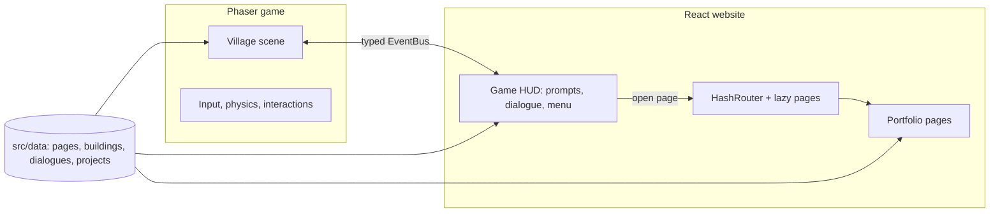

<div align="center">

# HEVIL'S WORLD

**An interactive developer portfolio you can walk through.**

Explore a pixel-art countryside village, talk to its villagers and step into its buildings to discover projects, test cases, vlogs, notes and experience. Prefer a regular website? Every page is one click away from the menu.


</div>



> **Status: in active development.** The village, navigation and project pages are built; the remaining pages and final art are in progress (see [Roadmap](#roadmap)). All artwork is currently a temporary placeholder generated in code.

## Highlights

- **A playable village as the homepage.** Walk, jump and explore a side-scrolling countryside with hills, a river, windmills and parallax mountains, built from reusable tiles rather than one big background image.
- **Seven portfolio locations.** My Home, Projects Workshop, Developer's Forge, Testing Laboratory, Knowledge Library, Vlog House, and the Resume & Contact Castle, each with a readable pixel signboard.
- **Villagers with branching dialogue.** NPCs with portraits, typewriter text and keyboard, number-key or mouse choices that lead straight to the matching page.
- **Never forced to play.** A header and a building menu reach every page, with optional "walk there" fast travel. Coming back to the village returns you to the door you used.
- **Data-driven content.** Projects, dialogues, buildings and pages are plain TypeScript data. Adding a project means adding one object; missing details show a clearly marked placeholder instead of invented text.
- **Crisp pixel art at any size.** The game renders at 480×270 and scales by whole numbers, so pixels stay sharp.
- **Static and fast.** No backend. Each page is its own lazy-loaded chunk, and the game engine downloads only when the village is opened.
- **Accessible by design.** Keyboard navigation, focus management, screen-reader announcements, and respect for the reduced-motion setting.

## Screenshots

| Dialogue with a villager | Resume & Contact Castle |
|---|---|
|  |  |

| Building menu (no walking required) | Projects |
|---|---|
|  |  |

## How it works

The project keeps the game and the website as two separate layers that talk through a small typed event bus.



- **Game (`src/game/`)**: Phaser 3 scenes, the player and NPCs, a data-driven tilemap, collision and an interaction system. It never imports React.
- **Website (`src/components/`, `src/pages/`)**: React pages, the HUD drawn over the canvas, navigation and pixel-block transitions.
- **Content (`src/data/`)**: framework-free data shared by both layers, so text lives in one place.

## Tech stack

| Area | Technology |
|---|---|
| UI | React 19, TypeScript 5.9, Tailwind CSS 4 |
| Game | Phaser 3.90 (Arcade physics, tilemaps) |
| Routing | React Router 7 with `HashRouter` for static hosting |
| Animation | GSAP for page transitions, loaded on first use |
| Tooling | Vite 8, ESLint with typescript-eslint |
| Hosting | GitHub Pages (static) |

## Getting started

**Prerequisites:** Node.js 22.12 or newer.

```bash
git clone https://github.com/HevilChaudhari/hevil-s-world-portfolio.git
cd hevil-s-world-portfolio
npm install
npm run dev
```

Open http://localhost:5173.

| Command | Purpose |
|---|---|
| `npm run dev` | Start the dev server with hot reload |
| `npm run build` | Type-check and build to `dist/` |
| `npm run preview` | Serve the production build locally (http://localhost:4173) |
| `npm run test` | Run the unit tests (Vitest) |
| `npm run check` | Type-check, lint, test and build in one step (what CI runs) |

### Controls

| Key | Action |
|---|---|
| A / D or ← / → | Walk |
| W / ↑ / Space | Jump |
| E | Talk, read, or enter a building |
| Esc | Open the menu |

On phones and tablets, on-screen controls appear instead (◀ ▶ to walk, **Jump**, **Use**). The **Simple view** button lists every page without the game.

## Project structure

```
src/
├── app/          App shell, routes, lazy page registry
├── components/   Game host and HUD, dialogue, layout, navigation, transitions
├── data/         Content: pages, buildings, NPCs, dialogues, projects, test cases
├── game/         Phaser game: scenes, entities, maps, systems, placeholder art
├── hooks/        Shared React hooks
├── pages/        One folder per page
├── types/        Content types
└── utils/        Helpers
docs/             Development guide and screenshots
public/           Static assets (art, audio, documents)
```

## Customising

- **Content** lives in `src/data/`: projects, test cases, vlogs, experience and the profile used by Resume and About. Each file starts with a commented example; anything left out shows a clearly marked *To be added* box.
- **Resume PDF:** put it at `public/documents/resume.pdf` and set `resumePdf: 'documents/resume.pdf'` in `src/data/profile.ts`.
- **Art:** all artwork is currently generated in code. To replace a piece, put the file in `public/assets/`, register it in `src/game/config/assetKeys.ts` under the same key, and keep the placeholder's size and frame layout.
- **Images and videos** for pages go in `public/assets/` and are referenced without a leading `/` (for example `assets/projects/<slug>/screen.png`), so they work on any base path.

The [development guide](docs/DEVELOPMENT.md) has the details: editing the village layout and dialogues, every data file, adding pages, the exact size of each art asset, and deployment.

## Roadmap

- [x] Project setup and architecture
- [x] Village environment and player movement
- [x] Collision and interaction system
- [x] Buildings, NPCs and dialogue
- [x] React integration, routing and navigation
- [x] Projects listing and data-driven project pages
- [x] Test Cases, Vlogs, Resume, Experience and About pages (data-driven; content being filled in)
- [ ] Technical Notes and Architecture pages
- [x] Mobile touch controls, Simple view and responsive layouts
- [x] Performance work and automated tests
- [x] Automated GitHub Pages deployment

## Deployment

The site is fully static and deploys to GitHub Pages with GitHub Actions (`.github/workflows/deploy.yml`).

1. In the repository, open **Settings → Pages** and set **Source** to **GitHub Actions** (one time).
2. Push to `main`. The workflow type-checks, lints, tests and builds, then publishes `dist/`.
3. The site appears at `https://<user>.github.io/<repository>/`, or at `https://<user>.github.io/` if the repository is named `<user>.github.io`.

The same build works at both addresses: it uses relative paths and hash routing (`/#/resume`), so the repository name is never hardcoded. Links without the hash, such as `/<repository>/resume`, are forwarded to the right page. Other branches and pull requests run the same checks without deploying (`.github/workflows/ci.yml`). See the [development guide](docs/DEVELOPMENT.md#deploying-to-github-pages) for details and troubleshooting.
